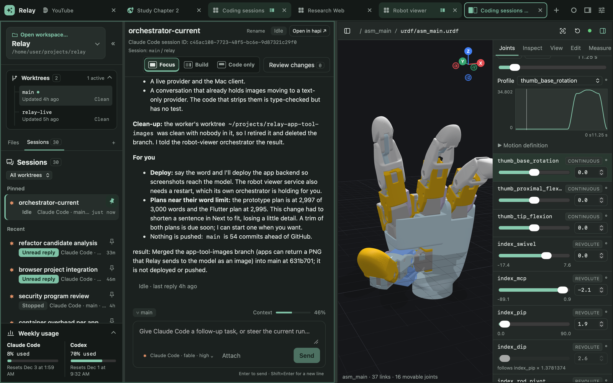

# Relay

**An AI agent that works inside your own apps.** Your apps open as tabs, with
one conversation beside them. Ask a question and the agent reads the apps you
connected, answers with sources, and shows the answer on the app's own screen.


## What it does

- **One conversation across your apps.** The chat stays open while you switch
  tabs, so one thread can compare what several apps show.
- **Answers with sources.** The agent cites the app record or page each answer
  came from, and can open that part of the app for you.
- **Any app can join.** An app joins through a [small HTTP protocol](docs/integration.md)
  and keeps its own screens and technology. Relay has no code for any
  particular app.
- **A built-in browser** (Flutter app). Ask about the page, a PDF or a YouTube video
  (through its transcript), capture part of the screen as an image, highlight
  text, and let the agent fill in a form for you to check and submit yourself.
- **Your files, read-only** (Flutter app). Share folders on your computer, and the agent
  can read and search them, but never change them.
- **A workspace that remembers.** Tabs, split views and the conversation come
  back after a restart, and other devices can open your tabs.



## How it works

```text
┌──────────────────┐  chat   ┌──────────────────┐  operations  ┌───────────┐
│ Flutter app or   │────────▶│ Relay service    │─────────────▶│ Your apps │
│ web page         │◀────────│ agent, records,  │◀─────────────│           │
│ (tabs + chat)    │         │ model keys       │              │           │
└──────────────────┘         └──────────────────┘              └───────────┘
         ▲                                                           │
         └──────────── app screens, shown in a web view ─────────────┘
```

1. Each app serves a short **manifest**: its name, what it is for, and how to
   use it.
2. When a question needs an app, the agent asks it for its **operations**
   (such as `layout.inspect` in the sample app) and calls them. Other apps'
   details stay out of the model's context.
3. An operation can return a **view** for the app to show, such as a section
   to highlight. The app draws it on its own screen inside Relay.

| Part | What it is |
| --- | --- |
| Service (`server/`) | Node 24, SQLite and the OpenCode agent runtime. It holds the records and makes every model call, with Claude, OpenAI or DeepSeek. |
| Flutter client (`flutter/`) | The main client, for the Mac. See its [README](flutter/README.md). |
| Web page (`web/`) | A React page served by the service, for other computers. |
| Apps | Your own websites that serve the protocol. |

## Design choices

- **Keys and records stay on your machine.** Conversations, memory and
  provider keys live only in the Relay service, never in the clients or apps.
- **The user takes the last step.** The agent fills in a form but never
  submits it; you check it and press Submit yourself.
- **Apps are kept apart.** Each app runs on its own origin, in a sandboxed
  frame unless you mark it as trusted, and the agent sees only what its
  operations return. Browsing history and highlights are never given to the
  agent or to apps.
- **Shared folders are read-only.** Hidden files such as `.env` and `.ssh`
  stay out of the agent's reach.
- **Safe on the network.** The service answers only its own address, so other
  websites cannot reach it through a renamed domain (DNS rebinding).

## Try it

You need Node 24.9 or later.

```sh
npm ci
npm run build
npm start
```

Open `http://127.0.0.1:3210`. Without an API key Relay runs a scripted demo,
so you can try chat right away.

To try the sample app, start it in one terminal and Relay in another:

```sh
node examples/room-layout/server.ts
RELAY_APPS_FILE=examples/room-layout/apps.json npm start
```

Choose **+ → Room layout** and send a message.

[Running Relay](docs/running.md) covers model keys, connecting your own app,
other devices, backups and starting your app servers from Relay.

## Where it's heading

The goal is a self-evolving workspace: one you change by talking to the agent
inside it, instead of waiting for someone else to ship a feature.

- **App creation.** Describe a tool you need, and the agent builds a new app
  or plugin, starts it and opens it as a new tab.
- **Bug fixing.** Tell the agent what went wrong, and it finds the cause in
  the app's code, fixes it and shows you the change before it goes live.
- **Self-evolution.** The same loop applies to every app and to Relay itself:
  new screens, operations and settings come from asking for them, so each
  workspace becomes highly customized to its owner.

The groundwork is in place: any app joins by address with no change to Relay,
the app list reloads without a restart, and Relay can start and stop app
servers. The missing piece is a safe place for code the agent writes: a
sandbox that gets only the files and network access it needs, where you
approve each change before it goes live.

## Status

Relay is a personal prototype in daily use. The Flutter app runs on macOS 14
or later. Windows uses the web page while a Windows build is in testing, and
a phone app comes later.

## Learn more

- [App protocol](docs/integration.md)
- [Architecture](docs/architecture.md)
- [Development guide](docs/development.md): building, testing and publishing
