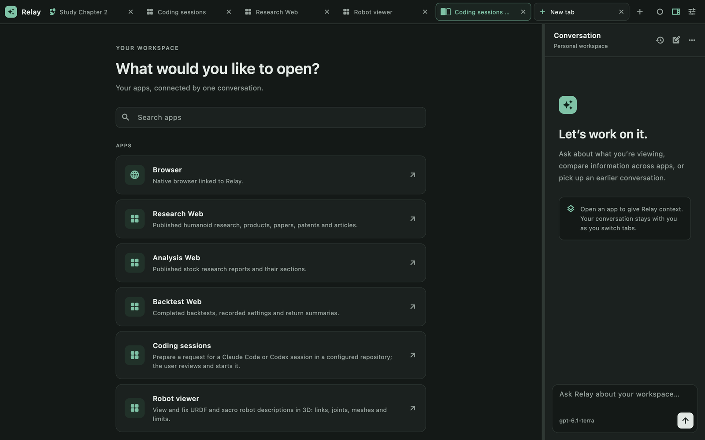

# Relay

**An AI agent that works inside your own apps.** Your apps open as tabs, with
one conversation beside them. Ask a question and the agent reads the apps you
connected, answers with sources, and shows the answer on the app's own screen,
for example by opening the right report section or playing a robot motion.



## What it does

- **One conversation across your apps.** The chat stays open while you switch
  tabs, so you can compare a research page, a stock report and a web page in
  one thread.
- **Answers with sources.** The agent cites the app record or page each answer
  came from, and can open that part of the app for you.
- **Any app can join.** An app joins through a [small HTTP protocol](docs/integration.md)
  and keeps its own screens and technology. Relay has no code for any
  particular app.
- **A built-in browser** (Flutter app). Ask about the page, a PDF or a YouTube video
  (through its transcript), capture part of the screen as an image, highlight
  text, and let the agent fill in a form for you to check and submit yourself.
- **Your files, read-only** (Flutter app). Share folders on your computer, and the agent
  can read and search them, but never change them.
- **A workspace that remembers.** Tabs, split views and the conversation come
  back after a restart, and other devices can open your tabs.

## Apps connected so far

Each app below lives in its own project and joins Relay by address alone.

| App | What the agent can do with it |
| --- | --- |
| **Browser** (built in) | Open websites, read pages, PDFs and video transcripts, and fill in forms without submitting them. |
| **Files** (built in) | Read and search the folders you share. |
| **Research Web** | Search a bilingual library of humanoid robot products, papers, patents and articles, and compare products without inventing missing values. |
| **Analysis Web** | Find saved stock research reports by ticker, quote a section, and open that section on screen. |
| **Backtest Web** | Find completed trading backtests and read their settings and returns. |
| **Coding sessions** | Write a request for a Claude Code or Codex session in one of your repositories. You read it, edit it, and press Start yourself. |
| **Robot viewer** | Read and fix URDF and xacro robot files, find problems such as missing meshes or bad joint limits, play a motion, and look at a screenshot of the result. Earlier versions of each file are kept, so a change can be undone. |
| **Room layout** | A small sample app in [`examples/room-layout`](examples/room-layout/README.md) that shows the whole protocol. |


## How it works

```text
┌──────────────────┐  chat   ┌──────────────────┐  operations  ┌───────────┐
│ Flutter app or   │────────▶│ Relay service    │─────────────▶│ Your apps │
│ web page         │◀────────│ agent, records,  │◀─────────────│           │
│ (tabs + chat)    │         │ model keys       │              │           │
└──────────────────┘         └──────────────────┘              └───────────┘
         ▲                                                           │
         └──────────── app screens, shown in a web view ─────────────┘
```

1. Each app serves a short **manifest**: its name, what it is for, and how to
   use it.
2. When a question needs an app, the agent asks it for its **operations**
   (such as `research.search` or `robot.inspect`) and calls them. Other apps'
   details stay out of the model's context.
3. An operation can return a **view** for the app to show, such as a section
   to highlight. The app draws it on its own screen inside Relay.

| Part | What it is |
| --- | --- |
| Service (`server/`) | Node 24, SQLite and the OpenCode agent runtime. It holds the records and makes every model call, with Claude, OpenAI or DeepSeek. |
| Flutter client (`flutter/`) | The main client, for the Mac. See its [README](flutter/README.md). |
| Web page (`web/`) | A React page served by the service, for other computers. |
| Apps | Your own websites that serve the protocol. |

## Design choices

- **Keys and records stay on your machine.** Conversations, memory and
  provider keys live only in the Relay service, never in the clients or apps.
- **The user takes the last step.** The agent fills in a form but never
  submits it, and writes a coding request but never starts it.
- **Apps are kept apart.** Each app runs on its own origin, in a sandboxed
  frame unless you mark it as trusted, and the agent sees only what its
  operations return. Browsing history and highlights are never given to the
  agent or to apps.
- **Shared folders are read-only.** Hidden files such as `.env` and `.ssh`
  stay out of the agent's reach.
- **Safe on the network.** The service answers only its own address, so other
  websites cannot reach it through a renamed domain (DNS rebinding).

## Try it

You need Node 24.9 or later.

```sh
npm ci
npm run build
npm start
```

Open `http://127.0.0.1:3210`. Without an API key Relay runs a scripted demo,
so you can try chat right away.

To try the sample app, start it in one terminal and Relay in another:

```sh
node examples/room-layout/server.ts
RELAY_APPS_FILE=examples/room-layout/apps.json npm start
```

Choose **+ → Room layout** and send a message.

[Running Relay](docs/running.md) covers model keys, connecting your own app,
other devices, backups and starting your app servers from Relay.

## Where it's heading

The goal is a workspace that grows with the person using it. When you need a
tool you don't have, you ask for it:

- **Ask for an app, get an app.** Describe what you need, and the agent
  writes a new app that serves the protocol, starts it, and opens it as a new
  tab.
- **Change apps by talking.** Ask for a new screen, operation or fix in an app
  you already use, and the agent updates it while you watch.
- **Relay evolves the same way.** The same flow applies to Relay's own client
  and service, so each workspace ends up shaped by its owner.

Several pieces already exist. Any app joins by address with no change to
Relay, and the app list reloads without a restart. Relay can start and stop
app servers. The Coding sessions app hands a written request to Claude Code or
Codex. Robot viewer redraws the moment an agent edits its files. The missing
piece is a safe place for code the agent writes: a sandbox that gets only the
files and network access it needs, where you approve each change before it
goes live.

## Status

Relay is a personal prototype in daily use. The Flutter app runs on macOS 14
or later. Windows uses the web page while a Windows build is in testing, and
a phone app comes later.

## Learn more

- [App protocol](docs/integration.md)
- [Architecture](docs/architecture.md)
- [Development guide](docs/development.md): building, testing and publishing
